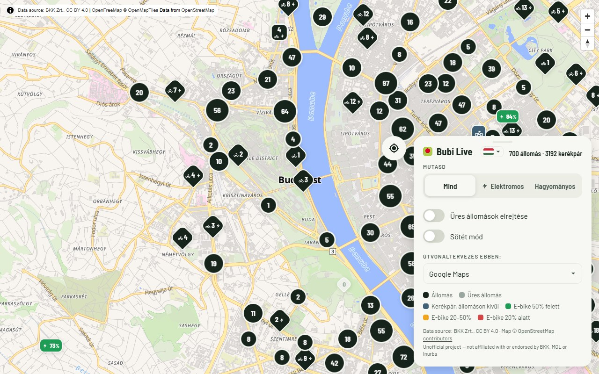

# Bubi Live — élő budapesti kerékpárkereső

**Magyar** | [English](README.en.md)



Gyors, valós idejű térkép a MOL Bubi állomásairól. Szűrhetsz elektromos,
hagyományos vagy mindkét típusú kerékpárra, elrejtheted az üres állomásokat, és
egy koppintással a hozzád legközelebbi bicikliket is megtalálod. Telepíthető a
kezdőképernyőre PWA-ként, asztali gépen is használható.

**Nem hivatalos projekt.** Nincs kapcsolatban a BKK-val, a MOL-lal vagy az
Inurbával, és ők sem támogatják. A MOL Bubi és a Bubi név a jogtulajdonosok
védjegye.

A `bubi-map-project-plan.md` specifikáció alapján készült, és **kizárólag a
nyilvános GBFS v2.3 adatfolyamot** használja: nincs bejelentkezés, nincs privát
API, nincs visszafejtés. A foglalt kerékpárokat már az adatforrás kihagyja az
elérhetőségi számokból, vagyis az „elérhető" azt jelenti, hogy a kerékpár éppen
szabadon bérelhető.

**Adatforrás: BKK Zrt., CC BY 4.0.** A CC BY 4.0 feltételeit és a pontos
forrásmegjelölést a BKK
[nyílt adat portálja](https://opendata.bkk.hu/data-sources) tartalmazza. Maga a
MOL Bubi adatfolyam az Urban Sharing nyilvános GBFS végpontjáról érkezik:
`https://gbfs.urbansharing.com/molbubi.hu`. A térképcsempéket az
[OpenFreeMap](https://openfreemap.org) adja — ingyenes vektorcsempék, API-kulcs
nélkül — OpenStreetMap-adatokból (© OpenStreetMap közreműködők, ODbL).

---

## Hogyan működik

```
GBFS adatfolyamok (Urban Sharing)
   │  a szerver 20 másodpercenként lekérdezi, Client-Identifier fejléccel
   ▼
Node.js + Express (memóriában tárol, adatbázis nélkül)
   ├─ összefésüli: station_information + station_status + vehicle_types
   ├─ GET /snapshot  → az aktuális adatkészlet (az oldal első betöltéséhez)
   ├─ GET /stream    → Server-Sent Events, minden új lekérdezést azonnal továbbít
   └─ GET /healthz   → életjel-ellenőrzés
   │  SSE-push, közvetlenül minden lekérdezés után
   ▼
Statikus frontend (MapLibre GL JS + Supercluster, sima JS)
   └─ a szűrés teljesen a kliensen történik, telepíthető PWA, forgatható térkép
```

Csak a `station_status` frissül 20 másodpercenként. A ritkán változó
adatfolyamok (`station_information`, `vehicle_types`) 10 percenként töltődnek
újra. A 20 másodperces ütem belefér a CC BY 4.0 által javasolt terhelési
korlátba (legfeljebb 15–30 másodpercenkénti frissítés). Ha egy lekérdezés
sikertelen, a szerver addig is az utolsó ismert jó pillanatképet szolgálja ki.

## Felépítés

```
bubi-map/
├── server/            # Express: gbfs.js (lekérés + összefésülés), index.js (útvonalak + SSE)
├── public/            # index.html, app.js, style.css, manifest.json, icons/
├── Dockerfile
└── docker-compose.yml
```

## Beállítások (környezeti változók, nem kötelezők)

| Változó              | Alapérték                   | Jelentés                                        |
|----------------------|-----------------------------|-------------------------------------------------|
| `PORT`               | `3000`                      | A szerver portja                                |
| `CLIENT_IDENTIFIER`  | `bubi-live-map`             | A `Client-Identifier` fejléc értéke             |
| `STATUS_INTERVAL_MS` | `20000`                     | Az állapotfrissítés gyakorisága (15000–30000)   |
| `STATIC_INTERVAL_MS` | `600000`                    | Az állomásadatok és járműtípusok frissítése     |
| `GBFS_BASE`          | az Urban Sharing éles URL-je | Az adatforrás címének felülírása (teszteléshez) |

## Futtatás helyben (Docker nélkül)

```bash
cd server
npm install
npm start          # → http://localhost:3000
```

## Megjegyzések és lehetséges továbbfejlesztések

- **Fürtszámok:** az állomásfürtök mostantól a bennük lévő állomások *összes
  kerékpárját* mutatják, nem az állomások számát. A Supercluster saját
  `point_count` értéke azt jelenti, hogy „hány elem olvadt össze", ami az
  állomásrétegen az állomások darabszámát adja. Ez más mértékegység, mint az
  app összes többi száma (jelölők, felugró ablakok, összesítő), amelyek mindig
  kerékpárt számolnak. Teljesen kicsinyítve ezért olyasmit láttál, mint „197"
  (gyakorlatilag a város összes állomása) közvetlenül egy „1 147 kerékpár"
  összesítő mellett. Ez technikailag helyes volt arra, amit számolt, de könnyű
  volt úgy érteni, hogy „összesen csak 197 kerékpár van". A javítás: a
  `countFor()` összegzi a fürt leveleit. A kerékpárfürtök eddig is jók voltak
  (minden levél egy kerékpár, így a `point_count` eleve kerékpárszám volt), és
  nem változtak.
- **Iránytű-irány:** a saját helyzetet jelző pont körül kis iránykúp jelenik meg,
  amint megbízható iránytűadat áll rendelkezésre — hasonlóan a Google Maps
  „merre nézek" jelzéséhez, szemben a GPS-mozgásból számolt iránnyal, ami
  álló helyzetben nem ad értéket, pedig épp akkor nézed a térképet. Az eszköz
  magnetométerét a `DeviceOrientationEvent` segítségével használja. Az
  engedélyt ugyanarról a „keress meg" koppintásról kéri, mert az iOS csak
  közvetlen felhasználói interakcióból engedi ezt a hívást. A MapLibre marker
  `rotation` és `rotationAlignment: 'map'` beállítása a térkép forgatásakor is
  automatikusan a valós irányba tartja a kúpot, kézi szögszámítás nélkül.
  Csendben visszaesik egyszerűbb működésre: ha nincs magnetométer, az engedélyt
  elutasították, vagy csak relatív (nem abszolút) tájolás érhető el, a jelölő
  sima pont marad, és nem mutat esetleg téves irányt.
- **Térképstílus:** a minimalista „Positron" helyett „Liberty" lett — az
  OpenFreeMap legrészletesebb stílusa (területhasználat, érdekes helyek,
  árnyaltabb úthierarchia), amely közelebb áll az eredeti raszteres OSM-hez, de
  továbbra is vektoros, így forgatáskor a feliratok egyenesek maradnak. Az
  URL-minta ugyanaz, ezért egy sor átírásával váltható
  (`/styles/positron`, `/styles/bright`, `/styles/liberty`).
- **Gördülékenyebb jelölők:** a fürtök nagyítás és forgatás közben fokozatosan
  válnak szét és olvadnak össze, nem egyszerre a mozdulat végén. Az
  összehangolás a `move` eseményre fut (animációs képkockánként legfeljebb
  egyszer, `requestAnimationFrame`-mel), nem csak a `moveend`-re.
- **Sötét mód:** alapból az operációs rendszer `prefers-color-scheme`
  beállítását követi, a beállításokban pedig kézzel felülbírálható (az érték a
  localStorage-ba kerül) — a megszokott „automatikus, de kézzel is állítható"
  megoldás. Két, egymástól független részből áll:
  - **Felület** (panelek, felugró ablakok, jelölők): a stíluslap minden színe
    CSS-változó, a sötét módú értékeket egyetlen
    `@media (prefers-color-scheme: dark)` blokk definiálja, mellette egy
    azonos tartalmú `html[data-theme="dark"]` blokk a kézi választáshoz (a kettő
    szinkronban tartva, ellenőrizve, hogy nincs eltérés). A kitöltött elemek
    (állomásjelölők, fürtök, tömör gombok) `--X`/`--on-X` színpárokat
    használnak, amelyek a két mód között egyszerűen felcserélődnek. Így a
    világos mód „sötét alak, világos tartalom" kombinációja sötét módban
    külön logika nélkül „világos alak, sötét tartalom" lesz. Valóban új színre
    csak az üres állomás megjelenítéséhez volt szükség, mert annak a *saját
    módjához képest* kell halványnak látszania, nem pusztán invertáltnak. Egy
    kivétel, ha később szerkeszted a fájlt: a `.select` legördülő nyila egy
    beégetett kitöltésű, data URI-ba ágyazott SVG, amely nem tud CSS-változót
    olvasni. Ezért saját, külön sötét módú felülírása van, és nem örökli
    automatikusan, mint minden más.
  - **Térkép**: a Liberty stílusnak (és minden más OpenFreeMap-stílusnak) nincs
    használható sötét változata — az OpenFreeMap karbantartója a Dark és Fiord
    stílust befejezetlennek jelöli. Ehelyett sötét módban egy CSS `filter`
    (`invert(90%) hue-rotate(180deg) brightness(95%) contrast(105%)`) kerül
    kizárólag a `.maplibregl-canvas` elemre. Mivel ez külön DOM-réteg a
    jelölőktől, felugró ablakoktól és paneltől, a szűrő semmi mást nem érint;
    ezt a MapLibre tényleges DOM-szerkezetének vizsgálatával ellenőriztem, nem
    csak feltételeztem. A színek nem művészi megfontolásból születtek (az invert
    az invert), de megmarad a Liberty részletgazdagsága, és nincs szükség a stílus
    újratöltésére.
- **Térképforgatás:** a térkép Leaflet helyett MapLibre GL JS-t használ, éppen a
  forgatás miatt. A kétujjas érintéses forgatás natívan működik, az iránytű
  gomb (jobb felül, a MapLibre saját zoomvezérlőjének része) mutatja az aktuális
  irányt, és koppintásra északra fordít. Az OpenFreeMap vektorcsempéi forgatás
  közben is vízszintesen tartják az utcaneveket, amire a raszteres csempék nem
  képesek. A `maxPitch: 0` beállítás sík, 2D forgatást ad, így nem lehet
  véletlenül megdönteni a térképet. A Leaflet.markercluster-nek nincs
  forgatásbarát megfelelője, ezért a fürtözés most közvetlenül a
  [Superclusteren](https://github.com/mapbox/supercluster) fut (ugyanaz a motor,
  amit a MapLibre belül is használ), saját HTML-jelölőkkel és fürtbuborékokkal.
  Ezeket stabil kulcs (állomás- vagy kerékpárazonosító) alapján egyezteti, így a
  megnyitott felugró ablak túléli az adatfrissítést, a szűrőváltást és a
  forgatást, ahelyett hogy alatta lebomlana és újraépülne. Egy buktató, ha
  újra hozzányúlsz a kódhoz: a MapLibre CSS `transform`-mal pozicionálja a
  markert azon a *pontos* elemen, amelyet átadsz neki — ugyanezt a tulajdonságot
  használja az állomásjelölő 45°-os rombuszforgatása is. Ezért minden marker
  vizuális tartalma egy szinttel *beljebb*, egy sima, stílusozatlan host `div`-ben
  él, nem közvetlenül a MapLibre által pozicionált elemen.
- **Állomásszámok és szabadon hagyott kerékpárok:** az állomások számai a
  `station_status`-ból érkeznek, ez a mérvadó forrás. A `free_bike_status`
  *minden* bérelhető kerékpárt felsorol, a dokkoltakat is, ezért a
  `BIKE_MATCH_RADIUS_M` (120 m) távolságon belüli kerékpárok kimaradnak — az
  állomás száma őket már tartalmazza. Ami megmarad, azok a **szabadon parkolt
  („laza") kerékpárok**, hagyományosak és elektromosak egyaránt, a saját
  GPS-pontjukon megjelenítve. A foglalt és letiltott (például majdnem lemerült)
  kerékpárok nem szerepelnek. Az akkumulátor-százalék a `current_range_meters`
  értékből számolódik, a hivatalos apphoz hangolt tartalékmodell szerint:
  `20 + 80 × hatótáv/65000` (55 km → 88%, 36 km → 64%, 3 km → 24%). Finomhangolás:
  `EBIKE_RESERVE_PCT` / `EBIKE_FULL_RANGE_M`. A `GET /healthz` ezeket jelenti:
  `loose_electric`, `loose_mechanical`, `docked_skipped`.
- **Jelölőnyelv:** a *forma* a szerepet jelzi (állomás = csepp, laza kerékpár =
  lekerekített négyzet), a *piktogram* a típust (villám = elektromos, kerékpár =
  hagyományos), a *szín* pedig kizárólag az e-bike akkumulátorszintjét. Az
  állomások egyetlen, majdnem fekete színt kapnak, hogy a zöld soha ne jelentsen
  két dolgot; a laza kerékpárok palakékek. „Mind" módban az állomásjelölő a szám
  *mellett* piktogramokat is mutat (balra kerékpár, jobbra villám), hogy látszódjon,
  mi van ott dokkolva. Az egyes típusok nézetében ezt már a szűrő megmondja, ezért
  ilyenkor elrejtjük. Az e-bike-ok az akkumulátorszintnek megfelelően színezett
  lapkák; a hagyományos kerékpárok palakékek, olyan színűek, amely nincs rajta az
  akkumulátorskálán. A jelmagyarázat minden színt felsorol: állomás, üres állomás,
  laza kerékpár és a három akkumulátorsáv. A laza kerékpárok csoportjai fekete,
  lekerekített négyzetek ugyanazokkal a piktogramokkal (alakjuk eltér a fekete
  állomáskörökétől), így a parkolt hagyományos kerékpárok csoportját soha nem
  lehet e-bike-csoportnak nézni.
- **Útvonaltervezés:** minden felugró ablakban két osztott gomb áll egymás
  mellett, azonos magasságban. Az egyik a térképalkalmazás-gomb: a fő része
  megnyitja az éppen kiválasztott appot (felirattal, hosszú név esetén
  rövidítve, nem tördelve), a nyíl pedig a többi alkalmazást listázza. Tőle
  jobbra a Böngésző/App módváltó gomb áll (csak ikon, földgömb vagy telefon,
  saját nyíllal). Bármelyik legördülőből választva csak az *alapértelmezés
  változik*, navigálás nem indul — az útvonaltervezés a térképalkalmazás nevére
  koppintva kezdődik. Mindkét legördülő a térkép fölé lebeg (`position:
  absolute`), nem nyújtja meg a felugró ablakot, így kinyitásuk soha nem
  változtatja annak méretét. Mindkét vezérlő megtalálható a beállításokban is;
  a négy vezérlő szinkronban van, és az utolsó választás alapértelmezésként
  mentődik. A mód opció csak akkor jelenik meg, ha az eszközön tényleg van app a
  kiválasztott szolgáltatóhoz: telefonon mindig, Macen az Apple Mapshez, sima
  asztali gépen soha. A Böngésző mód egyszerű https-hivatkozásokat használ; az App
  mód a natív sémára ad át (`comgooglemaps://`, `google.navigation:`, `maps://`,
  `waze://`), webes tartalék nélkül (a korábbi tartalék időzítő egyszerre nyitotta
  meg a böngészőt és az appot). Ha az app nincs telepítve, a koppintás nem csinál
  semmit — ilyenkor válts vissza Böngésző módra. Megjegyzés: iOS-en a
  `maps.apple.com` és a `waze.com/ul` *univerzális hivatkozásként* van
  regisztrálva, az iOS az apphoz irányítja őket, mielőtt a Safari látná, és ezt
  weboldalról nem lehet felülírni. Ezért e kettőnél a mód opció iPhone-on rejtett,
  ahelyett hogy olyan böngészős választást kínálnánk, amelyet az operációs
  rendszer figyelmen kívül hagy. A **keress meg** gomb élőben követi a
  felhasználót, pontossági gyűrűvel.
- **Javított hiba:** a térképalkalmazás vagy a Böngésző/App mód kiválasztása
  korábban bezárta a megnyitott felugró ablakot. Ezt a Leaflet.markercluster
  mellékhatása okozta, amely eldobja a marker felugró ablakát, ha az ikon vagy a
  fürttagság változik, a korábbi teljes `render()` pedig ezt kiváltotta. A
  beállításváltozások most csak a nyitott felugró ablak tartalmát frissítik
  helyben, az ablak nyitva marad.
- **Sávszélesség (SSE):** az élő SSE-kapcsolat szünetel, amikor a fül rejtett vagy
  háttérben van (Page Visibility API), így nem kap feleslegesen ~20
  másodpercenként egy push-t. Visszatéréskor egyszer lekéri a `/snapshot`
  végpontot, hogy utolérje magát, majd újranyitja a streamet. Az eleve rejtve
  betöltött oldal addig nem nyit kapcsolatot, amíg valaki tényleg meg nem nézi.
- **Sávszélesség (tömörítés):** a gzip-tömörítés minden HTTP-válaszra be van
  kapcsolva, az SSE `/stream`-re is. Egy valósághű pillanatkép (~197 állomás +
  ~80 laza kerékpár) tömörítetlenül ~49,5 KB, gzippel ~7,6 KB, vagyis nagyjából
  6,5-szeres a csökkenés. A 20 másodperces alapütemmel ez óránként ~8,7 MB és
  ~1,3 MB közti különbséget jelent egy nyitva hagyott fülnél. Az SSE-válaszokat
  minden írás után kifejezetten ki kell üríteni (`res.flush()`), mert a gzip belül
  pufferel, és flush nélkül a tömörített stream késleltetné az élő push-okat.
- **Javított hiba:** a jelölőfeliratok (állomásszámok, akkumulátor-százalék,
  fürtszámok) fix `px`-ben vannak méretezve `rem` helyett, az oldal pedig
  kikapcsolja az automatikus szövegméret-igazítást (`text-size-adjust: 100%`). A
  `rem` a gyökérelem betűméretéhez viszonyít, amit egyes mobilböngészők az
  operációs rendszer kisegítő beállításai vagy saját „kis szöveg felnagyítása"
  heurisztikájuk alapján skáláznak. Asztali teszteléskor ez nem látszik, de
  összezsugoríthatja a jelölő számát, amíg az már nem fér el a tűben, és az
  oldalsó piktogramokat is teljesen kiszoríthatja. A jelölőfeliratok fix méretű
  felületi elemek, pontos px-es konténerhez tervezve, ezért mostantól mindig
  ugyanakkorák, bármi legyen is az eszköz szövegméret-beállítása.
- **Javított hiba:** hat szöveg (a térképalkalmazás címkéje, a megnyitás címkéje,
  a térképválasztó aria-címkéje, a Böngésző/App opciók címkéi és a laza
  hagyományos kerékpárok címkéi) tévesen az angol objektumban szerepelt a magyar
  helyett, ezért a magyar nyelv náluk csendben angolra váltott. Javítva; mindhárom
  nyelv ugyanazt a kulcskészletet tartalmazza (diff-fel ellenőrizve).
- A terv szerint az első verzió hatókörén kívül esik: a bérlés és feloldás, a
  fiókkezelés, az előzmények és más városok támogatása. A frontend
  `Útvonaltervezés` hivatkozása a Google Mapsbe mélylinkel az adott állomásra
  mutat. A hivatalos app bérlési folyamatának bekötéséhez hitelesített privát
  API-ra és BLE-re volna szükség, ezt szándékosan kihagytuk.

## Licenc és forrásmegjelölés

- **Kód:** MIT — lásd a [LICENSE](LICENSE) fájlt.
- **Adat:** © BKK Zrt., CC BY 4.0. A licenc szerint a forrást így kell
  feltüntetni: **„Data source: BKK Zrt., CC BY 4.0"**. Az app ezt a térkép
  forrásmegjelölésében és a beállítások panelen is megjeleníti.
  [Licencösszefoglaló](https://creativecommons.org/licenses/by/4.0/deed.hu).
- **Térkép:** © OpenStreetMap közreműködők, ODbL. Csempék:
  [OpenFreeMap](https://openfreemap.org).
- **Védjegyek:** a MOL Bubi és a Bubi név a jogtulajdonosok tulajdona. Ez egy nem
  hivatalos projekt, nincs kapcsolatban a BKK-val, a MOL-lal vagy az Inurbával,
  és ők sem támogatják.
